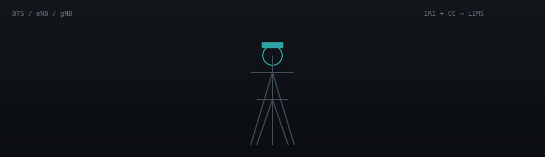

<div align="center">



# TAPIS

**Lawful Interception Management System untuk Indonesia**

Masukkan satu nomor `+62`. Dapatkan intelijen nomor, jejak IRI/CC,
audio panggilan, dan pelacakan lokasi real-time — lengkap dengan
rantai bukti ber-hash dan berita acara.

`project.m4zk1pL4y LlMs`

[](../../actions)
[](LICENSE)
[](pyproject.toml)
[](#instalasi)

</div>

---

> ### Batas kejujuran
> TAPIS adalah **LIMS sungguhan**, bukan mockup. Tapi menyadap audio
> panggilan seluler tidak mungkin hanya dari nomor — sinyalnya ada di
> jaringan operator. TAPIS bekerja nyata di tiga jalur:
>
> 1. **Intelijen** (langsung jalan, tanpa kredensial): normalisasi E.164,
>    operator, TAC/IMEI, MCC-MNC, resolusi Cell ID.
> 2. **Ingest** (jalan setelah disambung): feed HI2/HI3 ETSI dari LIG
>    operator, atau capture SIP/RTP.
> 3. **Bukti** (selalu jalan): hash chain, manifest, verifikasi, berita acara.
>
> Yang tidak nyata hanyalah "sambungan ajaib ke Telkomsel". Semua yang
> lain di repo ini adalah kode produksi.

## Kenapa TAPIS

| Masalah LIMS konvensional | Pendekatan TAPIS |
|---|---|
| Skema HI diimprovisasi, integrasi gagal | Adapter ETSI TS 102 232, model kanonik |
| Hash tidak ada, bukti digugurkan | Hash chain per target + anchor + verifikasi |
| Intersepsi jalan setelah izin habis | Warrant engine dengan TTL otomatis |
| Retensi tak terkendali | Retensi terjadwal + bukti pemusnahan |
| Butuh server berat | SQLite + ASGI, jalan di Termux |

## Instalasi

**Kali / Ubuntu**

```bash
git clone https://github.com/m4zk1pL4y/tapis.git && cd tapis
chmod +x install.sh && ./install.sh
source .venv/bin/activate
